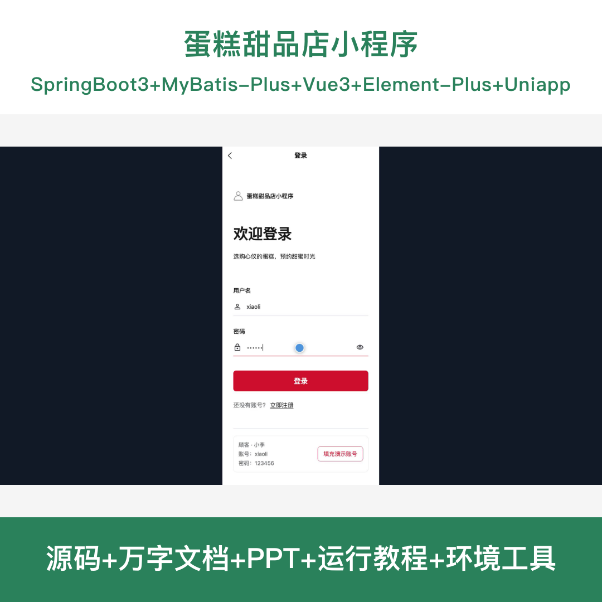
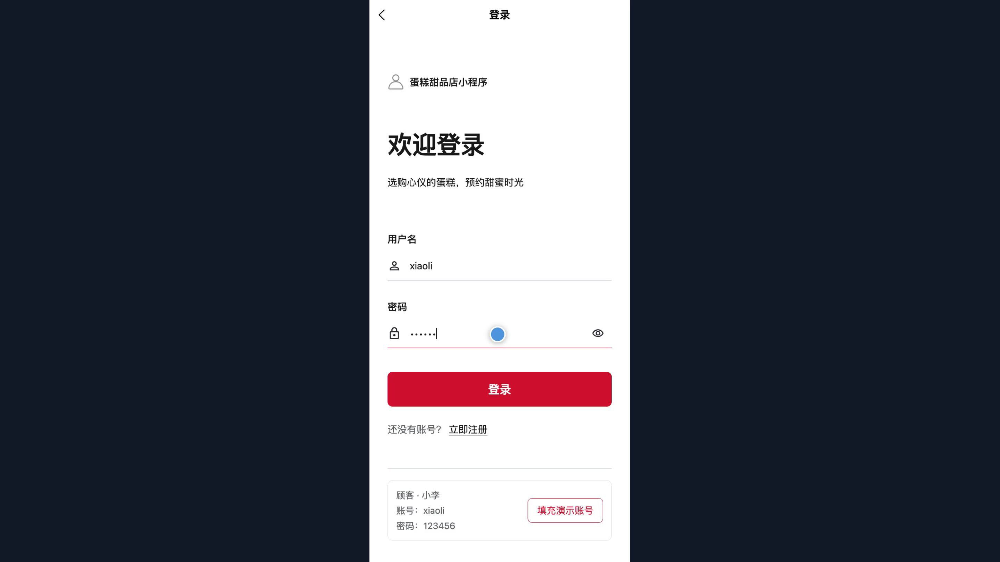
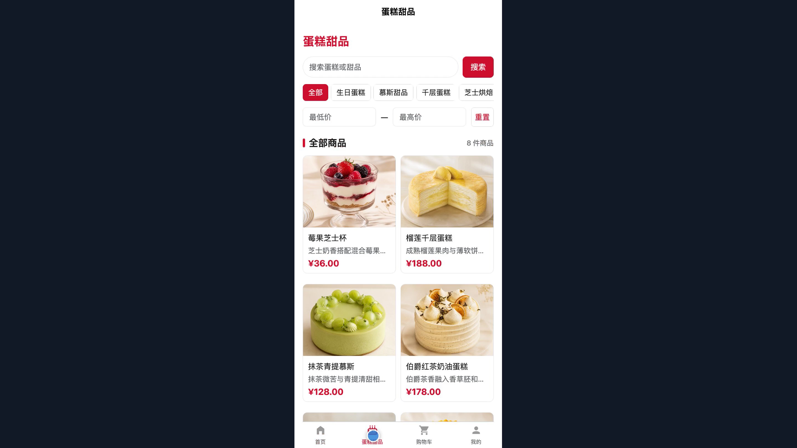
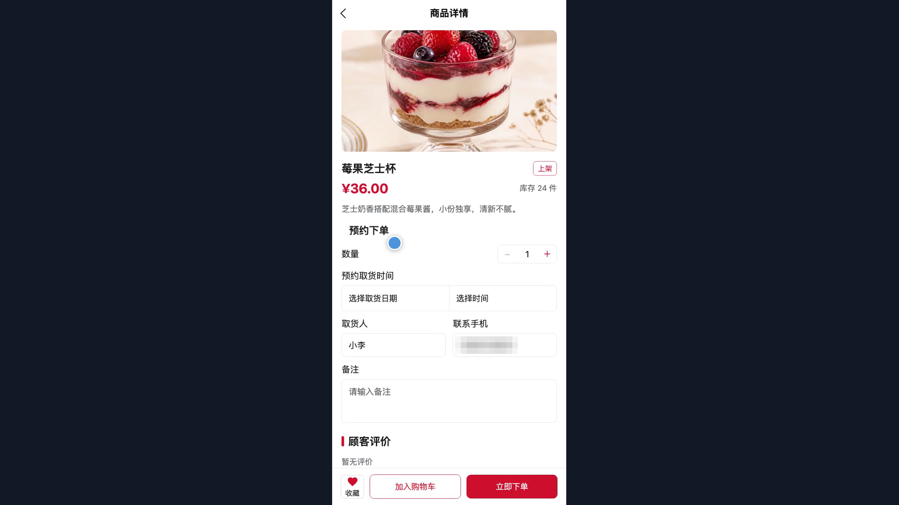
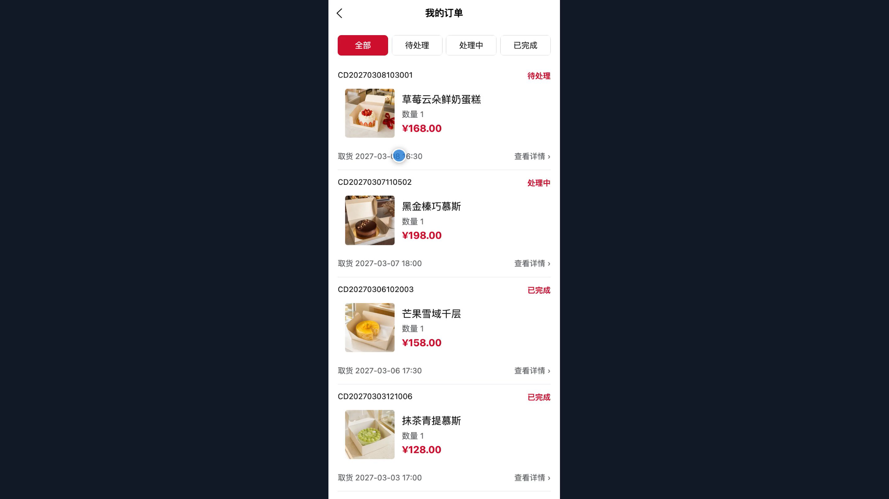
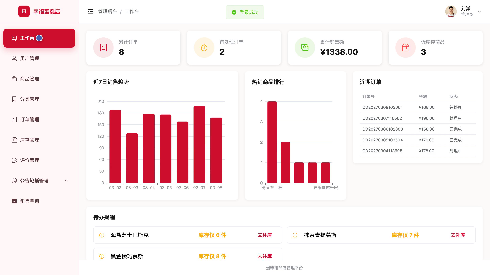
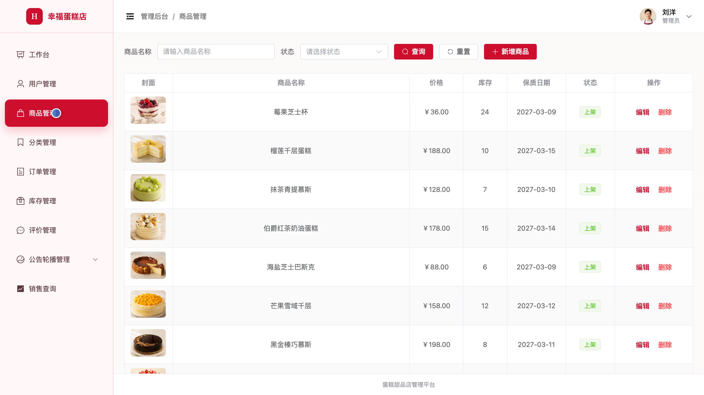
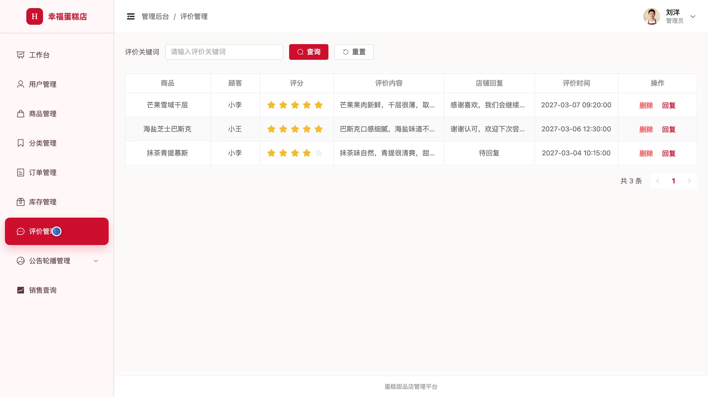

## 源码问题查看主页咨询

### 一、关键词
蛋糕甜品、甜品预订、蛋糕选购、购物车、到店取货

### 二、作品包含
源码+数据库+全套环境和工具资源+本地部署教程

### 三、项目技术
前端技术： Html、Css、Js、Vue3.4、Element-Plus、uniapp
后端技术：Java、SpringBoot3.2.0、MyBatis-Plus

### 四、运行环境要求
开发工具：IDEA/eclipse + VSCODE + HBuilder X + 微信开发者工具

数据库：MySQL5.7（共13张表）

数据库管理工具：Navicat10以上版本

环境配置软件： JDK17 + Maven3.6

前端Nodejs：16+

浏览器：谷歌浏览器

### 五、项目介绍
项目编号：bs107B

蛋糕甜品店小程序面向顾客提供蛋糕甜品浏览、商品收藏、购物车与预约取货下单，并支持订单查询、取消申请和完成后评价；管理员通过后台维护商品分类、库存、订单、用户及公告轮播，查看销售统计。

角色：用户、管理员

用户功能：蛋糕甜品浏览与筛选、商品详情与顾客评价阅读、商品收藏管理、购物车管理、预约取货下单、订单查询与取消申请、已完成订单评价提交、个人资料与密码管理。

管理员功能：商品与分类管理、订单处理、库存管理、用户管理、评价管理、公告与轮播管理、销售统计、个人资料管理。

### 六、运行截图

